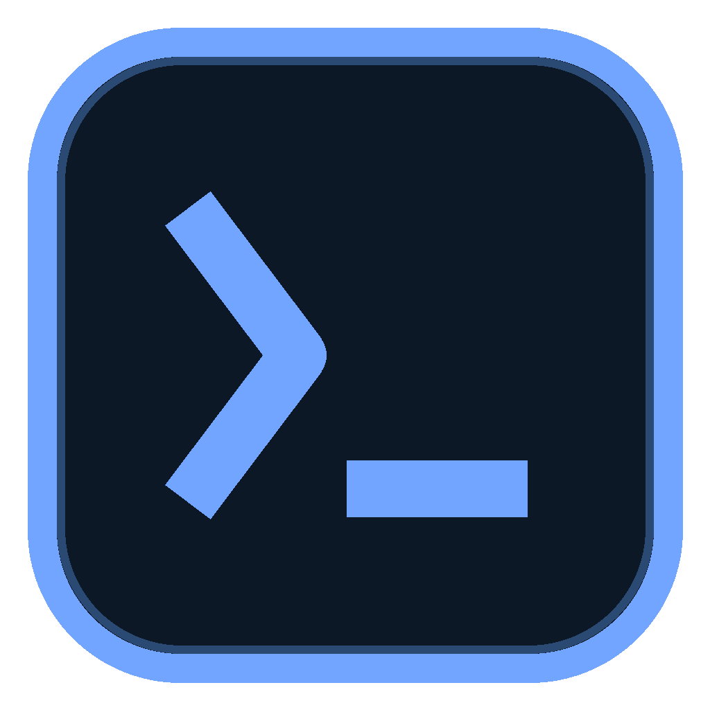
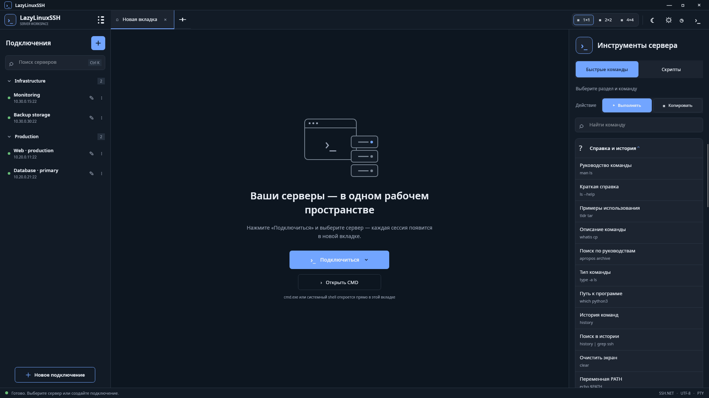
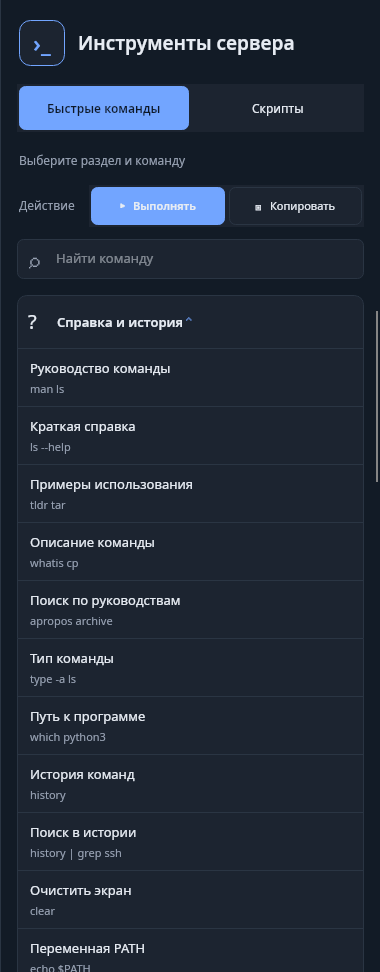
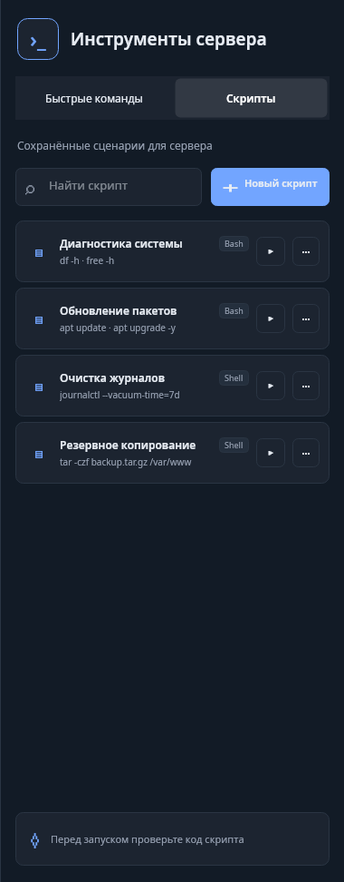
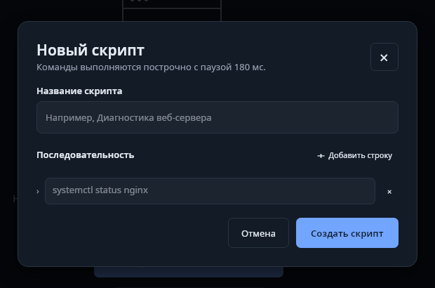

<div align="center">

**English · [Русский](README.md)**



# LazyLinuxSSH

### Your Linux servers under control. Without the routine.

A desktop application for SSH connections, PTY terminals, quick commands,<br />
and custom server scripts — all in one clean workspace.


</div>

> [!IMPORTANT]
> **This project is still under development.** The interface and features continue to evolve. Ideas, suggestions, and bug reports are very welcome — please share them in the repository **Issues**.

## What is it?

**LazyLinuxSSH** helps you manage Linux servers without assembling your workflow from a dozen separate tools. Connections and groups, independent terminals, a local CMD, a built-in file editor, a Linux command catalog, and saved scripts all live in one application.

The project is built with **C# 12, .NET 8, and Avalonia UI**, uses **SSH.NET**, and stores data locally in **SQLite**.

## Interface



<p align="center"><sub>One workspace for servers, tabs, terminals, and server tools.</sub></p>

## Features

| Servers and terminals | Commands and automation |
| --- | --- |
| SSH connection profiles and groups | 29 categories and 483 Linux/Bash commands |
| Independent tabs and 1×1, 2×2, 4×4 grids | One-click execution or copying |
| PTY, ShellStream, ANSI/VT, and UTF-8 | Custom scripts with search and editing |
| Built-in `cmd.exe` on Windows | Templates for the quick-command panel |
| KeepAlive, heartbeat, and reconnect overlay | History of commands actually executed |
| Dark/light themes and RU/EN interface | Confirmation for potentially dangerous commands |

### Quick commands and scripts

<table>
  <tr>
    <td width="50%" align="center">
      <br />
      <strong>Quick commands</strong><br />
      <sub>Offline catalog, search, accordion categories, and Run / Copy modes.</sub>
    </td>
    <td width="50%" align="center">
      <br />
      <strong>Custom scripts</strong><br />
      <sub>Compact cards, search, run, copy, edit, and delete.</sub>
    </td>
  </tr>
</table>

<sub>The screenshots use demonstration data. The script list is empty on first launch — the application never creates records automatically.</sub>

### Server script editor

<p align="center">
  
</p>

Create a sequence of one or more commands, save it locally, and run it in the active terminal. Editing updates the existing script instead of creating a duplicate. Copying code does not count as execution and is not added to history.

## Platforms

| Platform | Status |
| --- | --- |
| **Windows x64** | Available now |
| **macOS Apple Silicon** (`osx-arm64`) | Build `.dmg` on a MacBook |
| **macOS Intel** (`osx-x64`) | Build `.dmg` on a MacBook |

## Windows installation

The latest installer will be published in the **Releases** section of this GitHub repository.

1. Open **Releases**.
2. Download the latest `LazyLinuxSSH-Setup-<version>-win-x64.exe`.
3. Run the installer and follow the instructions.

The installer provides a self-contained build, so you do not need to install the .NET Runtime separately. An uninstaller is added automatically. To remove the application, use **Windows Settings → Apps → Installed apps → LazyLinuxSSH**. User data in `%APPDATA%\LazyLinuxSSH` is preserved during uninstallation.

## macOS installation

Build the `.dmg` files on a MacBook (the script publishes both runtimes itself — a separate `dotnet build` is not required):

```bash
chmod +x installer/build-macos.sh
./installer/build-macos.sh 1.0.0
```

Output: `artifacts/installer/LazyLinuxSSH-1.0.0-osx-arm64.dmg` and `...-osx-x64.dmg`. Details: [installer/Установка-macOS.md](installer/Установка-macOS.md). Unsigned build: first launch via **Right-click → Open**.

## Run from source

### Requirements

- [.NET 8 SDK](https://dotnet.microsoft.com/download/dotnet/8.0);
- Windows or macOS.

Clone the repository, open a terminal in its root directory, and run:

```bash
dotnet restore LazyLinuxSSH.sln
dotnet run --project src/LazyLinuxSSH.Desktop/LazyLinuxSSH.Desktop.csproj
```

For a Release run:

```bash
dotnet run --project src/LazyLinuxSSH.Desktop/LazyLinuxSSH.Desktop.csproj -c Release
```

### Build the installer yourself

**Windows** — install **Inno Setup 6 or 7**, then from the project root:

```powershell
powershell -ExecutionPolicy Bypass -File .\installer\build-installer.ps1 -Version 1.0.0
```

Output: `artifacts\installer\LazyLinuxSSH-Setup-1.0.0-win-x64.exe`. Details: [installer/Установка-и-удаление.md](installer/Установка-и-удаление.md).

**macOS** — on a MacBook:

```bash
./installer/build-macos.sh 1.0.0
```

Output: `artifacts/installer/LazyLinuxSSH-1.0.0-osx-arm64.dmg` and `...-osx-x64.dmg`. Details: [installer/Установка-macOS.md](installer/Установка-macOS.md).

The scripts run restore, self-contained publish, and packaging themselves — you do not need to build the project beforehand. If you encounter `NU1301`, check NuGet access.

## Feature details

### Workspace

- The plus button opens the start tab; clicking a profile creates a new independent SSH tab.
- When profiles exist, **Connect** opens a saved-server popup; selecting a server closes the popup and starts a session.
- Groups can be expanded and collapsed, with their state preserved while filtering; server search is available via `Ctrl+K`.
- The connection panel collapses from 300 to 64 px while keeping the list and add buttons accessible.
- Each terminal tab independently remembers its 1×1, 2×2, or 4×4 layout.
- An empty grid cell can host another open session without closing its original tab.
- Closing a session removes it from every grid while preserving the other tabs.
- Closing the main window hides the application to the system tray; full exit is available from the tray menu.

### Terminal and local shell

- SSH authentication by password or private key, with PTY and asynchronous I/O through SSH.NET.
- ANSI colors, core CSI/SGR/OSC sequences, cursor movement, and screen clearing.
- Visual wrapping of long lines without changing the ANSI/VT buffer contents.
- New output does not jump back to the beginning: the terminal keeps recent responses and the next input area visible.
- **Open CMD** starts `cmd.exe` on Windows directly in the current tab, without an external window.
- The local editor receives focus automatically; Windows CMD displays input, Backspace, and `Ctrl+C`.
- KeepAlive, heartbeat, and a reconnect overlay help recover from disconnects without crashing the application.
- Dragging a single file onto an SSH console uploads it into the session’s current directory (overlay + upload indicator).

### Linux/Bash command catalog

The built-in offline catalog contains **29 categories and 483 commands**: navigation, files, grep, systemd, networking, performance, eBPF, SELinux, LVM/RAID, Docker, and system recovery.

- Search by name, description, category, or command text; press `Ctrl+F` for quick access.
- **Run** sends a command to the active terminal; **Copy** places it on the clipboard.
- Expanding one category automatically collapses the others.
- Dangerous actions are marked and require confirmation before being sent over SSH.
- Replace placeholders such as `PID`, `URL`, `host`, and `file` with real values.
- There is no add button at the bottom: custom sequences are created on the **Scripts** tab.

The catalog source and MIT attribution are preserved in [CREDITS.md](CREDITS.md).

### Server scripts

- First launch starts with an empty list — no demonstration records.
- Create a name and a multiline shell-command sequence.
- Search by name and contents.
- `Bash` badge for multiple lines and `Shell` for a single command.
- Run scripts regardless of the quick-command Run/Copy mode.
- Edit without changing the Id, copy code, or delete via the `⋯` menu.
- Persist scripts in SQLite between launches.
- History is updated only after actual execution, not after copying.

Review script code and replace placeholders with real values before running anything.

### Built-in file editor

The commands `nano`, `vim`, `vi`, and `nvim` with a single file path are intercepted before the terminal TUI starts and open an editor over the current terminal. No project file tree is added.

- Absolute paths (`nano /etc/hosts`), `~`, `~/...`, quotes, backslash, and the `--` separator.
- Relative paths from the shell’s current directory: `nano README.md`, `nano docker-compose.yml`, `nano nginx.conf`, `nano .env` — before opening, the app queries the real `pwd` so the file is resolved in the folder after `cd`, not under `$HOME`.
- Read, save, and download SSH files through a separate asynchronous SFTP connection.
- `Ctrl+S`, UTF-8 saving without BOM, and creation of missing files.
- Line numbers, current-line highlighting, selection, copy/cut/paste, and `Ctrl+F`.
- Copy the entire document and use the native download dialog.
- Download the original file or the current contents when unsaved changes exist.
- A green checkmark after a successful download and an × button to return to the terminal.
- The editor status shows the full path; if the file is missing — “File not found (…path…)”.

Compound commands, redirection, `sudo nano ...`, and other unsupported forms are not intercepted. The editor is intended for UTF-8 text files up to 16 MB; binary files and text containing NUL are rejected without crashing the terminal session.

### Settings, templates, and history

- The system `Default` template contains the entire catalog and is read-only.
- Custom templates use a **category → commands** tree with checkboxes.
- Tree categories start collapsed, and only one category is expanded at a time.
- Save templates to SQLite, apply them to the panel, and edit them later.
- Saved scripts are not part of templates and are unchanged when templates switch.
- Instantly switch between RU and EN, with the choice saved in `ui-preferences.json`.
- Dark and light themes with an animated moon/sun transition.
- A unified history of quick, custom, and manually entered SSH/local commands, with copy, refresh, and clear-all actions.

## Data and security

By default, data is stored in `%APPDATA%\LazyLinuxSSH` on Windows and in the user's ApplicationData directory on other operating systems.

- Passwords and passphrases are encrypted **before saving**.
- Windows uses the current user's **DPAPI**.
- Operating systems without DPAPI use **AES-GCM**; a key can be supplied through `LAZYLINUXSSH_MASTER_KEY`.
- Without that environment variable, Unix creates a local `.vault-key` accessible only to the user.
- `LAZYLINUXSSH_DATA_DIR` overrides the data directory.
- Eye buttons only change temporary input masking and never weaken secret storage.
- Input at password/passphrase prompts and typical values of `--password`, `--token`, `--secret`, and `--api-key` are not stored in history as plain text.
- Existing SQLite schema upgrades preserve profiles, groups, and history.

Data from an earlier application version is not migrated automatically. To keep existing profiles, copy the contents of the previous data directory to `%APPDATA%\LazyLinuxSSH` before the first launch. On Windows, DPAPI secrets remain available to the same user; on Unix, the previous key or `.vault-key` must also be preserved.

## Technology and architecture

- **.NET 8, C# 12, Avalonia UI**;
- **MVVM**, Dependency Injection, and Clean Architecture;
- **SSH.NET 2026.0.0**;
- **SQLite + Entity Framework Core 8**;
- `Core`, `Infrastructure`, `Desktop`, and `Tests` projects.

```text
src/
├── LazyLinuxSSH.Core/            # Models, interfaces, and business logic
├── LazyLinuxSSH.Infrastructure/  # SSH, SQLite, EF Core, and data services
└── LazyLinuxSSH.Desktop/         # Avalonia UI, ViewModels, and workspace
tests/
└── LazyLinuxSSH.Tests/           # Unit and integration tests
```

## Tests

```bash
dotnet test LazyLinuxSSH.sln -c Release
```

The current Release suite contains **57 automated tests** covering the catalog, dangerous commands, tabs, grids, input, history, templates, editors, script CRUD and execution, copy-without-execution, localization, and language persistence.

A separate opt-in integration test covers real SSH PTY and SFTP: input/output, health checks, text-file write/read/download, and stale state.

Environment variables for this test:

- `LAZYLINUXSSH_TEST_KEY` — path to the test private key;
- `LAZYLINUXSSH_TEST_PORT` — test SSH server port, default `2222`;
- `LAZYLINUXSSH_TEST_USER` — user, defaulting to the current user.

## Terminal limitations

The built-in VT/ANSI parser supports core sequences and colors, but it is not a complete emulation of every modern terminal feature. Complex full-screen TUI applications may have display limitations.

## Feedback and contributions

The project is evolving, and feedback is especially valuable. If you have an idea for the interface, commands, scripts, SSH stability, or platform support, open an **Issue** describing your proposal. Bug reports with reproduction steps are also welcome.

Before contributing code, please read the [contributing guide](CONTRIBUTING.md). It covers project setup, Pull Request requirements, tests, localization, and security.

<div align="center">

**If you find LazyLinuxSSH useful, give the repository a ⭐ — it helps the project grow.**

</div>
