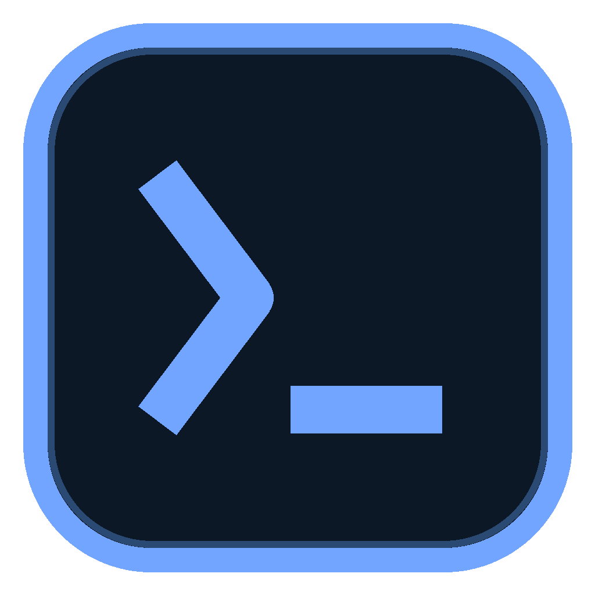
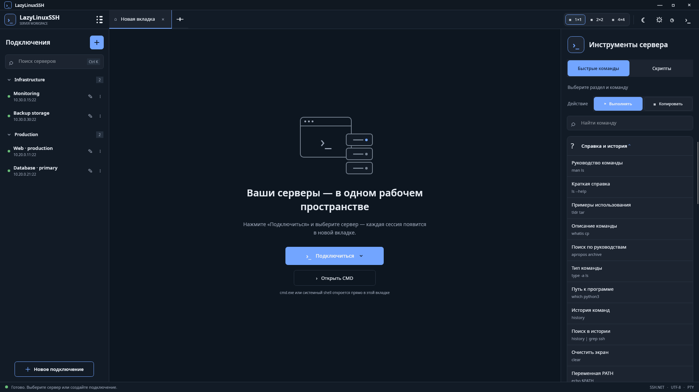
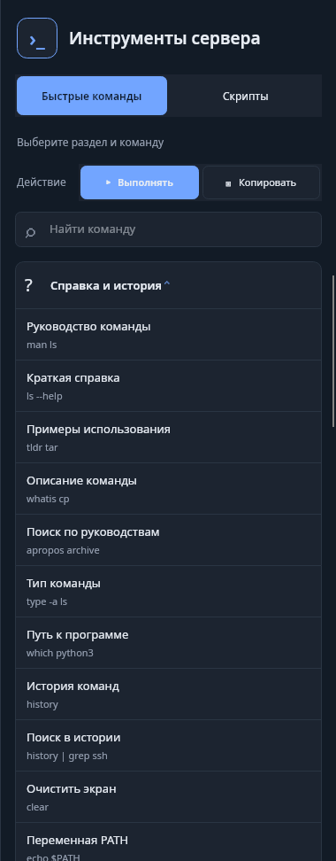
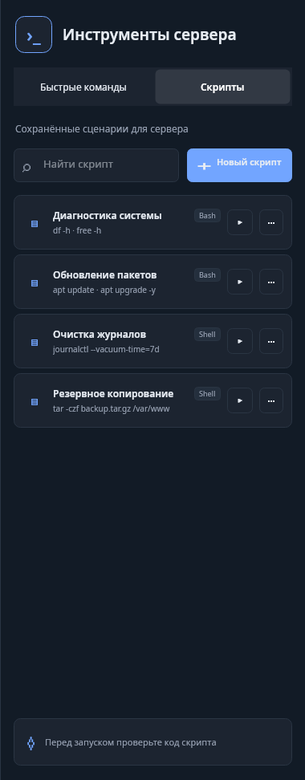
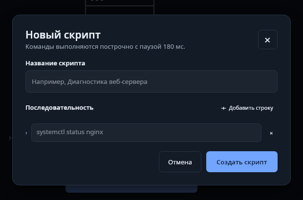

<div align="center">

**[English](README.en.md) · Русский**



# LazyLinuxSSH

### Linux-серверы под контролем. Без лишней рутины.

Desktop-приложение для SSH-подключений, PTY-терминалов, быстрых команд<br />
и собственных серверных скриптов — в одном аккуратном рабочем пространстве.


</div>

> [!IMPORTANT]
> **Проект ещё в разработке.** Интерфейс и возможности продолжают улучшаться. Буду рад предложениям, идеям и сообщениям об ошибках — их можно оставить в **Issues** репозитория.

## Что это?

**LazyLinuxSSH** помогает управлять Linux-серверами, не собирая рабочий процесс из десятка отдельных инструментов. Подключения и группы, независимые терминалы, локальный CMD, встроенный редактор файлов, каталог Linux-команд и сохранённые скрипты находятся в одном приложении.

Проект создан на **C# 12, .NET 8 и Avalonia UI**, использует **SSH.NET** и хранит данные локально в **SQLite**.

## Интерфейс



<p align="center"><sub>Единое рабочее пространство: серверы, вкладки, терминалы и инструменты сервера.</sub></p>

## Возможности

| Серверы и терминалы | Команды и автоматизация |
| --- | --- |
| Профили и группы SSH-подключений | 29 категорий и 483 Linux/Bash-команды |
| Независимые вкладки и сетки 1×1, 2×2, 4×4 | Выполнение или копирование в один клик |
| PTY, ShellStream, ANSI/VT и UTF-8 | Собственные скрипты с поиском и редактированием |
| Встроенный `cmd.exe` на Windows | Шаблоны состава панели быстрых команд |
| KeepAlive, heartbeat и reconnect overlay | История фактически выполненных команд |
| Тёмная/светлая тема и интерфейс RU/EN | Подтверждение потенциально опасных команд |

### Быстрые команды и скрипты

<table>
  <tr>
    <td width="50%" align="center">
      <br />
      <strong>Быстрые команды</strong><br />
      <sub>Офлайн-каталог, поиск, категории-аккордеоны и режимы «Выполнять» / «Копировать».</sub>
    </td>
    <td width="50%" align="center">
      <br />
      <strong>Собственные скрипты</strong><br />
      <sub>Компактные карточки, поиск, запуск, копирование, редактирование и удаление.</sub>
    </td>
  </tr>
</table>

<sub>На скриншотах использованы демонстрационные данные. При первом запуске список скриптов пуст — приложение не создаёт записи автоматически.</sub>

### Редактор серверных скриптов

<p align="center">
  
</p>

Создайте последовательность из одной или нескольких команд, сохраните её локально и запускайте в активном терминале. Редактирование обновляет существующий скрипт, а не создаёт дубликат. Копирование кода не считается выполнением и не попадает в историю.

## Платформы

| Платформа | Статус |
| --- | --- |
| **Windows x64** | Доступно сейчас |
| **macOS** | Поддержка появится позже |

## Установка на Windows

Актуальный установщик будет опубликован в разделе **Releases** этого GitHub-репозитория.

1. Откройте **Releases**.
2. Скачайте последний `LazyLinuxSSH-Setup-<версия>-win-x64.exe`.
3. Запустите установщик и следуйте инструкциям.

Установщик собирает self-contained версию: отдельно устанавливать .NET Runtime не нужно. Деинсталлятор добавляется автоматически, а удалить приложение можно через **Параметры Windows → Приложения → Установленные приложения → LazyLinuxSSH**. Пользовательские данные в `%APPDATA%\LazyLinuxSSH` при удалении сохраняются.

## Запуск из исходного кода

### Требования

- [.NET 8 SDK](https://dotnet.microsoft.com/download/dotnet/8.0);
- Windows для текущей поддерживаемой конфигурации приложения.

Клонируйте репозиторий, откройте терминал в его корне и выполните:

```bash
dotnet restore LazyLinuxSSH.sln
dotnet run --project src/LazyLinuxSSH.Desktop/LazyLinuxSSH.Desktop.csproj
```

Для Release-запуска:

```bash
dotnet run --project src/LazyLinuxSSH.Desktop/LazyLinuxSSH.Desktop.csproj -c Release
```

### Самостоятельная сборка установщика

На Windows дополнительно установите **Inno Setup 6 или 7**, затем выполните в PowerShell из корня проекта:

```powershell
powershell -ExecutionPolicy Bypass -File .\installer\build-installer.ps1 -Version 1.0.0
```

Результат появится здесь:

```text
artifacts\installer\LazyLinuxSSH-Setup-1.0.0-win-x64.exe
```

Скрипт последовательно выполняет restore, Windows x64 self-contained publish и сборку installer/uninstaller. Фирменная иконка используется приложением, окном, треем, ярлыками, установщиком и записью деинсталляции.

При ошибке `NU1301` проверьте доступность `https://api.nuget.org/v3/index.json`, DNS, прокси, VPN и брандмауэр. Не компилируйте `.iss` напрямую: сначала необходимы восстановление пакетов и публикация приложения.

## Подробнее о возможностях

### Рабочее пространство

- кнопка «плюс» открывает стартовую вкладку, а клик по профилю создаёт новую независимую SSH-вкладку;
- при наличии профилей кнопка «Подключиться» открывает popup сохранённых серверов; выбор закрывает popup и открывает сессию;
- группы раскрываются и сворачиваются, состояние сохраняется при фильтрации; поиск серверов работает через `Ctrl+K`;
- панель подключений сворачивается с 300 до 64 px, оставляя постоянно доступные список и кнопку добавления;
- режимы 1×1, 2×2 и 4×4 сохраняются отдельно для каждой терминальной вкладки;
- свободная ячейка сетки позволяет разместить в ней другую открытую сессию, не закрывая её исходную вкладку;
- при закрытии сессии она удаляется из всех сеток, а остальные вкладки сохраняются;
- закрытие главного окна скрывает приложение в системный трей; полный выход доступен в меню трея.

### Терминал и локальный shell

- SSH-подключение по паролю или закрытому ключу, PTY и асинхронный ввод-вывод через SSH.NET;
- ANSI-цвета, основные CSI/SGR/OSC-последовательности, движение курсора и очистка экрана;
- визуальный перенос длинных строк без изменения содержимого ANSI/VT-буфера;
- новый вывод не сбрасывает документ к началу: терминал удерживает последние ответы и область следующего ввода;
- «Открыть CMD» запускает `cmd.exe` на Windows прямо в текущей вкладке, без внешнего окна;
- локальный редактор получает фокус автоматически; Windows CMD отображает ввод, Backspace и `Ctrl+C`;
- KeepAlive, heartbeat и reconnect overlay помогают переживать разрывы без падения приложения.

### Каталог Linux/Bash-команд

Встроенный офлайн-каталог содержит **29 категорий и 483 команды**: навигация, файлы, grep, systemd, сеть, производительность, eBPF, SELinux, LVM/RAID, Docker и восстановление системы.

- поиск по названию, описанию, категории и тексту команды; быстрый вызов — `Ctrl+F`;
- «Выполнять» отправляет команду в активный терминал, «Копировать» помещает её в буфер обмена;
- при раскрытии одной категории остальные автоматически сворачиваются;
- опасные действия помечены и требуют подтверждения перед отправкой в SSH;
- placeholders вроде `PID`, `URL`, `host`, `file` нужно заменить реальными значениями;
- нижней кнопки добавления нет: пользовательские последовательности создаются на вкладке «Скрипты».

Источник каталога и MIT attribution сохранены в [CREDITS.md](CREDITS.md).

### Скрипты сервера

- первый запуск начинается с пустого списка — без демонстрационных записей;
- создание названия и многострочной последовательности shell-команд;
- поиск по названию и содержимому;
- тип `Bash` для нескольких строк и `Shell` для одиночной команды;
- запуск независимо от режима «Выполнять/Копировать» быстрых команд;
- редактирование без изменения Id, копирование кода и удаление через меню `⋯`;
- хранение в SQLite между запусками;
- история пополняется только после фактического запуска, а не после копирования.

Перед запуском проверяйте код скрипта и заменяйте placeholders реальными значениями.

### Встроенный редактор файлов

Команды `nano`, `vim`, `vi` и `nvim` с одним путём перехватываются до запуска терминального TUI и открывают редактор поверх текущего терминала. Файловое дерево проекта не добавляется.

- абсолютные пути, `~`, `~/...`, относительные пути, кавычки, backslash и разделитель `--`;
- чтение, сохранение и скачивание SSH-файлов через отдельное асинхронное SFTP-соединение;
- `Ctrl+S`, сохранение в UTF-8 без BOM и создание несуществующего файла;
- номера строк, подсветка текущей строки, выделение, copy/cut/paste и `Ctrl+F`;
- копирование всего содержимого и системный диалог скачивания;
- скачивание исходного файла или текущего содержимого при несохранённых изменениях;
- зелёная галочка после успешного скачивания и возврат к терминалу крестиком.

Составные команды, redirection, `sudo nano ...` и другие неподдерживаемые формы не перехватываются. Используйте простой вариант вида `nano /etc/hosts`. Редактор предназначен для текстовых UTF-8-файлов до 16 МБ; бинарные файлы и текст с NUL отклоняются без падения терминальной сессии.

### Настройки, шаблоны и история

- системный шаблон `Default` содержит весь каталог и доступен только для чтения;
- пользовательские шаблоны настраиваются деревом «раздел → команды» с чекбоксами;
- категории дерева по умолчанию свёрнуты, одновременно раскрыта только одна;
- сохранение в SQLite, применение к панели и последующее редактирование;
- сохранённые скрипты не входят в шаблоны и не меняются при их переключении;
- мгновенное переключение RU/EN с сохранением выбора в `ui-preferences.json`;
- тёмная и светлая темы с анимированной сменой луны и солнца;
- единая история быстрых, пользовательских и вручную введённых SSH-/локальных команд с копированием, обновлением и полной очисткой.

## Данные и безопасность

По умолчанию данные хранятся в `%APPDATA%\LazyLinuxSSH` на Windows и в каталоге ApplicationData пользователя на других ОС.

- пароли и парольные фразы шифруются **перед сохранением**;
- на Windows используется **DPAPI текущего пользователя**;
- на ОС без DPAPI применяется **AES-GCM**; ключ можно задать через `LAZYLINUXSSH_MASTER_KEY`;
- без переменной ключа на Unix создаётся локальный `.vault-key` с доступом только для пользователя;
- `LAZYLINUXSSH_DATA_DIR` переопределяет каталог данных;
- кнопки с глазом меняют только временную маску ввода и не ослабляют хранение секретов;
- ввод на password/passphrase-запросах и типовые значения `--password`, `--token`, `--secret`, `--api-key` не сохраняются в истории в открытом виде;
- обновление существующей SQLite-схемы не удаляет профили, группы и историю.

Данные предыдущей версии автоматически не переносятся. Чтобы сохранить профили, скопируйте содержимое прежнего каталога данных в `%APPDATA%\LazyLinuxSSH` до первого запуска. На Windows DPAPI-секреты доступны тому же пользователю; на Unix также необходимо сохранить прежний ключ или `.vault-key`.

## Технологии и архитектура

- **.NET 8, C# 12, Avalonia UI**;
- **MVVM**, Dependency Injection и Clean Architecture;
- **SSH.NET 2026.0.0**;
- **SQLite + Entity Framework Core 8**;
- проекты `Core`, `Infrastructure`, `Desktop`, `Tests`.

```text
src/
├── LazyLinuxSSH.Core/            # Модели, интерфейсы и бизнес-логика
├── LazyLinuxSSH.Infrastructure/  # SSH, SQLite, EF Core и сервисы данных
└── LazyLinuxSSH.Desktop/         # Avalonia UI, ViewModels и рабочее пространство
tests/
└── LazyLinuxSSH.Tests/           # Модульные и интеграционные тесты
```

## Тесты

```bash
dotnet test LazyLinuxSSH.sln -c Release
```

Текущий Release-набор содержит **57 автотестов**: каталог, опасные команды, вкладки, сетки, ввод, историю, шаблоны, редакторы, CRUD и запуск скриптов, копирование без выполнения, локализацию и сохранение языка.

Отдельно доступен opt-in integration-тест реального SSH PTY и SFTP: ввод-вывод, health check, запись, чтение и скачивание текстового файла, а также stale state.

Переменные для его запуска:

- `LAZYLINUXSSH_TEST_KEY` — путь к тестовому закрытому ключу;
- `LAZYLINUXSSH_TEST_PORT` — порт тестового SSH-сервера, по умолчанию `2222`;
- `LAZYLINUXSSH_TEST_USER` — пользователь, по умолчанию текущий.

## Ограничения терминала

Встроенный VT/ANSI-парсер поддерживает основные последовательности и цвета, но не является полноценной эмуляцией всех возможностей современных терминалов. Сложные полноэкранные TUI-приложения могут отображаться с ограничениями.

## Предложения и участие

Проект развивается, и обратная связь особенно полезна. Если у вас есть идея по интерфейсу, командам, скриптам, стабильности SSH или поддержке платформ — создайте **Issue** с описанием предложения. Сообщения об ошибках с шагами воспроизведения также приветствуются.

Перед внесением кода прочитайте [руководство для участников](CONTRIBUTING.md): там описаны запуск проекта, требования к Pull Request, тестам, локализации и безопасности.

<div align="center">

**Если LazyLinuxSSH оказался вам полезен, поставьте репозиторию ⭐ — это поможет развитию проекта.**

</div>
